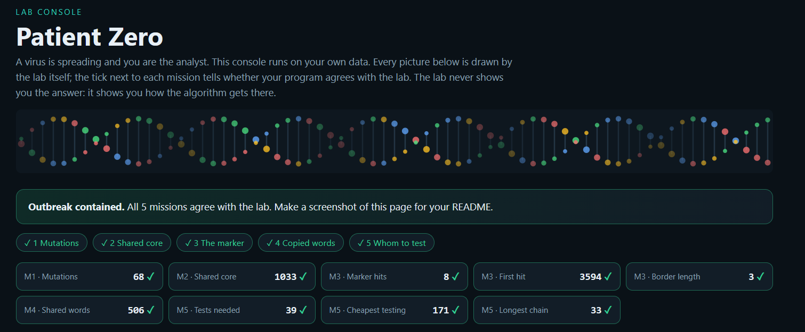
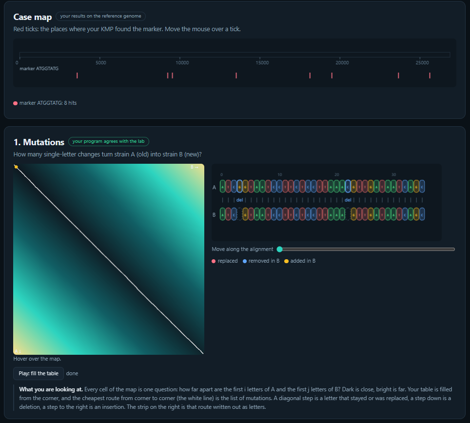
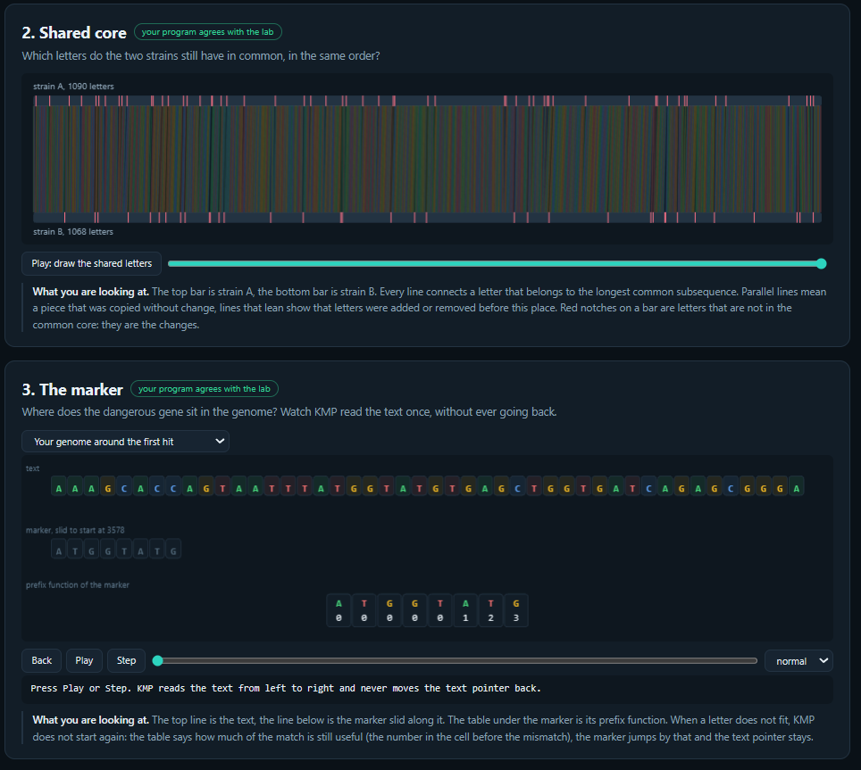
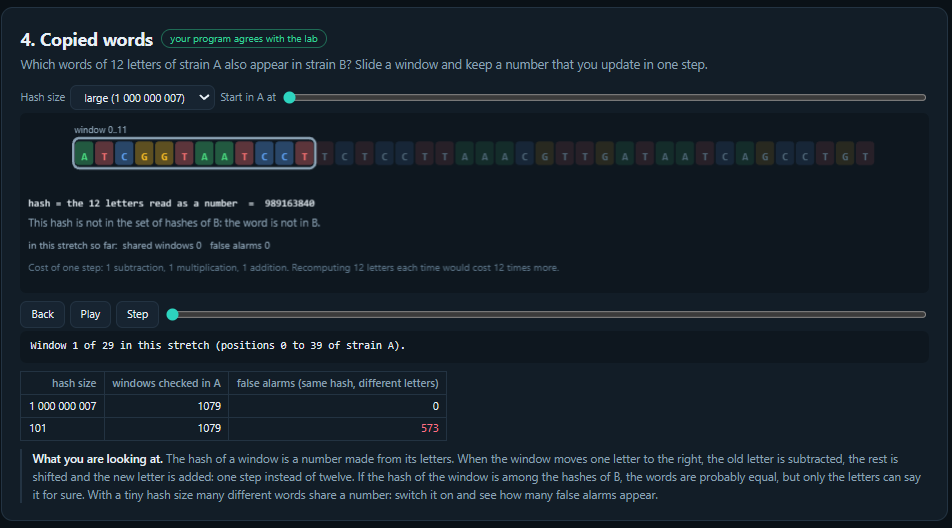
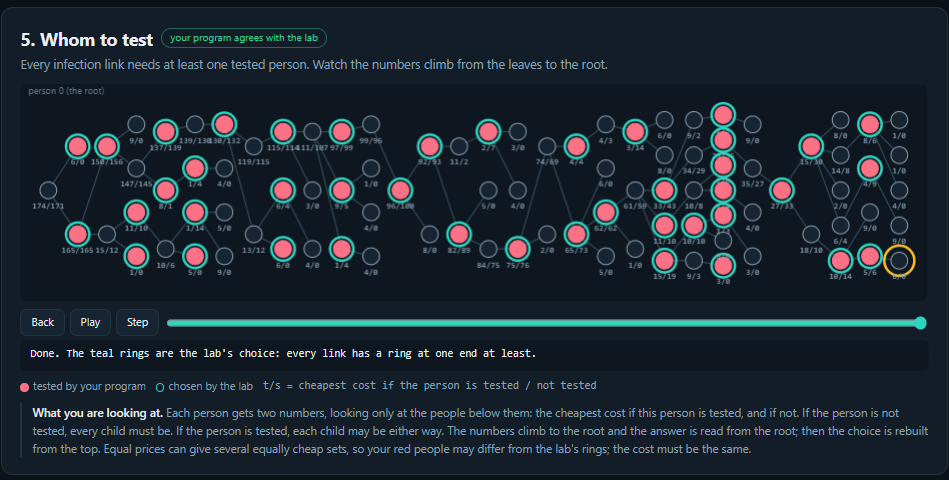

# Assignment 4. Patient Zero

Student ID: 253570
Name: Zhansir Sergeyev
Group: SE-2512

This file is the report. Fill it in as you go. How to start: `START_HERE.md`. The task: `docs/Assignment4.pdf`.

## Program output

The 9 lines your program prints on your data (`java -cp out Main`):

    Mutations: 68
    Shared core: 1033
    Marker hits: 8
    First hit: 3594
    Border length: 3
    Shared words: 506
    Tests needed: 39
    Cheapest testing: 171
    Longest chain: 33

My outbreak report (a screenshot of `output/outbreak.html`):

## Questions

Answer in your own words, two or three sentences each.

Mission 1. What does the cell d[i][j] of your table mean, and how is it computed from other cells?
The cell `d[i][j]` represents the minimum edit distance (Levenshtein distance) between the prefix of length `i` of strain A and the prefix of length `j` of strain B. It is computed from three adjacent smaller cells: `d[i-1][j] + 1` (deletion), `d[i][j-1] + 1` (insertion), and `d[i-1][j-1] + cost` (replacement or match, where cost is 0 if letters are identical and 1 if they differ).

Mission 2. How is the longest common subsequence different from the longest common substring? My Shared core is bigger than the number of letters that are the same at the same place: why?
The longest common subsequence consists of matching characters that appear in both strings in the same relative order, but not necessarily contiguous like in a substring. The Shared core value is larger than the count of exact positional matches because insertions and deletions in the virus strains create positional shifts. LCS accounts for these gaps and finds overall matching subsequences across shifted positions.

Mission 3. What does the prefix function tell you, and why does the pointer in the text never go back in KMP? What is the Border length of my marker and what does it mean?
The prefix function `pi[i]` stores the length of the longest proper prefix of pattern `p[0..i]` that is also a suffix of `p[0..i]`. The text pointer in KMP never moves backward because when a mismatch occurs, the prefix function indicates the longest valid match already aligned, allowing us to safely shift the pattern pointer instead. The Border length of my marker is 3, which means the last value of the prefix function `pi[m-1]` is 3 (the longest proper prefix of the marker that matches its suffix has length 3).

Mission 4. Why must you compare the letters after the hashes are equal? What happens to the cost of Rabin-Karp if many windows have the same hash?
Letter comparison is required after a hash match because different 12-letter sequences can produce identical hash values (known as hash collisions). If many windows produce the same hash, Rabin-Karp suffers from excessive false alarms, triggering frequent $O(k)$ character comparisons for non-matching strings. This degrades the time performance of Rabin-Karp from its optimal $O(n + m)$ average time towards $O(n \cdot m)$ worst-case time complexity.

Mission 5. What are the two states of a person in your DP, and how do you get the answer for a person from its children? Why does a greedy "test the person with most links first" not always give the cheapest answer?
The two DP states for person `v` are `take[v]` (the minimum testing cost if `v` is tested) and `skip[v]` (the minimum testing cost if `v` is not tested). If `v` is skipped, all its direct children must be tested (`skip[v] = sum(take[child])`), whereas if `v` is tested, each child can independently choose its minimum cost (`take[v] = cost[v] + sum(min(take[child], skip[child]))`). A greedy strategy based on degree centrality fails because choosing a highly connected node might be locally optimal, but testing several cheap adjacent child nodes could result in a lower overall cumulative testing cost.

## AI use

Gemini was used as an interactive AI collaborator throughout this assignment. It helped explain key algorithm concepts (edit distance, KMP, Rabin-Karp, tree DP), reviewed and debugged custom Java implementations for all missions, and assisted in generating structured Markdown report documentation.

## Timing (Mission 7)

Milliseconds, average of 3 runs, from `java -cp out Bench`.

| test | size | time |
|---|---|---|
| naive search | 20 000 / 40 000 / 80 000 | 95.3 ms / 180.8 ms / 370.1 ms |
| KMP | 20 000 / 40 000 / 80 000 | 4.6 ms / 2.4 ms / 0.7 ms |
| edit distance | 500 / 1000 / 2000 / 4000 | 9.9 ms / 12.3 ms / 32.5 ms / 121.2 ms |

What do the numbers say about how the time grows? When you double the size, by how much does each time grow? Two or three sentences.
The naive search demonstrates linear growth $O(n)$, doubling its execution time from ~95 ms to ~180 ms and ~370 ms as the text size doubles. KMP runs extremely fast with linear time complexity $O(n+m)$, showing near-instant execution due to zero backtracking on worst-case patterns. Edit distance exhibits quadratic growth $O(n^2)$, where doubling the sequence size from 2000 to 4000 increases execution time roughly fourfold from ~32.5 ms to 121.2 ms.

## Complexity

n is the length of the text (or of a strain), m the length of the pattern, k the length of the window, v the number of people. Fill in every algorithm you wrote.

| algorithm | time | space | assumptions |
|---|---|---|---|
| Edit distance | $O(n \cdot m)$ | $O(n \cdot m)$ | $n, m$ are lengths of strain A and B |
| LCS | $O(n \cdot m)$ | $O(n \cdot m)$ | $n, m$ are lengths of strain A and B |
| Prefix function and KMP | $O(n + m)$ | $O(m)$ | $n$ is text length, $m$ is pattern